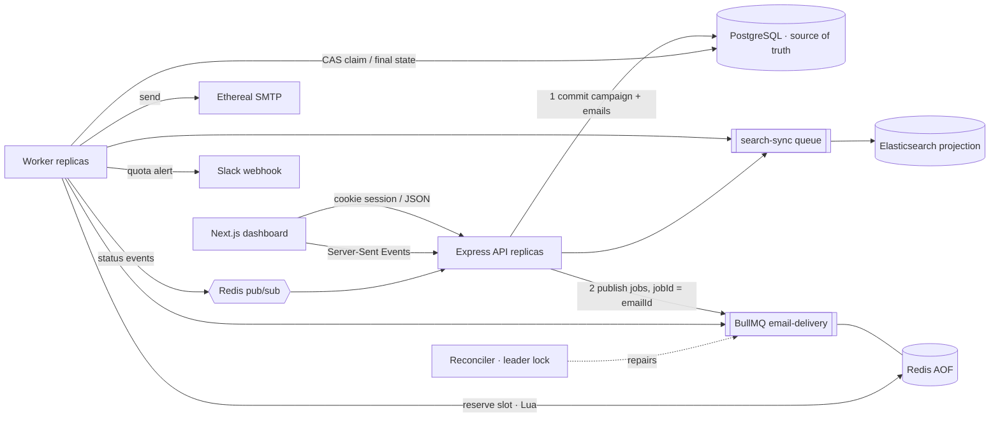

# ReachInbox Scheduler

A durable, horizontally scalable email scheduler: an Express + TypeScript API, BullMQ workers on Redis, PostgreSQL as the source of truth, Elasticsearch search, Ethereal SMTP, and a Next.js dashboard with live updates.

The design goal is simple to state and hard to get right: **an accepted email is never lost, never sent twice by the system's own doing, and never breaks a pacing or hourly limit, no matter how many API and worker replicas run.** Every one of those claims has a test that runs against real PostgreSQL and Redis.

## Highlights

| Concern               | How it is solved                                                                                                                                                                                                                                                                                                                     |
| --------------------- | ------------------------------------------------------------------------------------------------------------------------------------------------------------------------------------------------------------------------------------------------------------------------------------------------------------------------------------ |
| Durability            | Campaign and recipients commit in one transaction before any job exists. BullMQ jobs use the email ID as job ID. A leader-elected reconciler re-creates any job that Redis lost (no cron).                                                                                                                                           |
| Idempotent API        | Client key + SHA-256 of the canonical payload. Same key and payload → original result (`replayed: true`); same key, new payload → `409`. 10 concurrent identical requests create one campaign (tested).                                                                                                                              |
| No double processing  | Workers claim a row with a compare-and-set `UPDATE … WHERE status = 'SCHEDULED'`; exactly one of 25 concurrent claimers wins (tested). Expired leases are reclaimable.                                                                                                                                                               |
| Crash after SMTP send | A Redis delivery receipt is written the moment SMTP accepts. A retry finds it and only finishes bookkeeping, so a database blip cannot cause a second email. A stable `Message-ID` lets receivers drop the rare remaining duplicate.                                                                                                 |
| Pacing and quotas     | One Redis Lua script **reserves a send slot**: `slot = max(now, last + interval)`, then charges sender, campaign, tenant, and global sliding-hour quotas at that slot. O(1) Redis calls per email, no polling storms. Over-quota jobs wait until the oldest counted send leaves the hour window (with jitter) and are never dropped. |
| Scale-out             | Stateless API, any number of workers. All coordination (quotas, pacing, HTTP rate limits, session revocation, reconciliation lock, live events) lives in Redis. Keys carry a `{tenant}` hash tag, so the Lua scripts stay valid on Redis Cluster.                                                                                    |
| Search                | Versioned index behind an alias (`emails` → `emails-v2`), e-mail-aware analyzer, prefix search, fuzzy match, highlights. Writes go through a retrying `search-sync` queue using `updatedAt` as an external version, so out-of-order updates can never leave a stale status.                                                          |
| Live dashboard        | Workers publish status changes on Redis pub/sub; each API replica fans them out over Server-Sent Events.                                                                                                                                                                                                                             |
| Security              | Google OAuth (verified email only) with signed state + nonce; JWT sessions with a Redis deny-list for instant logout; Slack webhook and token encrypted with AES-256-GCM; Origin + Fetch-Metadata CSRF checks; tenant filter on every query.                                                                                         |
| Operations            | Structured pino logs with request IDs, `/health` (dependency latencies), `/health/live`, Prometheus `/metrics` (queue depth, oldest-job age, sends, deferrals, prevented duplicates, lease reclaims), Bull Board for operators, graceful shutdown with a deadline.                                                                   |

## Architecture



The life of one email:

```text
API commit ─► job delayed until scheduledAt
           ─► worker: receipt? ── yes ─► mark SENT (no resend)
                       │ no
                       ▼
              reserve slot (Lua: pacing + 3 hourly quotas)
                 ├─ quota full ─► delay until the oldest send leaves the 1-hour window (+jitter), Slack alert once per hour
                 ├─ slot later ─► delay until slot (quota already charged)
                 ▼
              start guard (real send starts ≥ interval apart)
              CAS claim  SCHEDULED → PROCESSING  (one winner)
              SMTP send ─► receipt in Redis ─► SENT in PostgreSQL ─► SSE + search sync
                 └─ SMTP error ─► SCHEDULED + BullMQ backoff, or FAILED after 5 attempts
```

Read more: [documentation index](docs/README.md), [architecture and failure matrix](docs/architecture/overview.md), [decision records](docs/adr/), [OpenAPI contract](docs/api/openapi.yaml), [demo script](docs/guides/demo-script.md), [assignment checklist](docs/project/assignment-brief.md).

## Measured

`pnpm loadtest --emails 2000 --senders 20 --replicas 4 --concurrency 16 --interval 50` (four worker replicas in one process competing through Redis, in-process SMTP stub, laptop):

| Metric                                  | Result                                               |
| --------------------------------------- | ---------------------------------------------------- |
| Throughput                              | ≈ 250 emails/s (cap 400/s)                           |
| Emails attempted more than once         | 0 of 2,000                                           |
| Smallest gap between one sender's sends | 48 ms for a 50 ms interval (2 ms is timestamp noise) |

Throughput scales with the number of senders, because spacing is per sender, not global. The load test fails if any invariant breaks.

## Features done

**Backend**

- Schedule API with idempotency; campaign and emails stored in PostgreSQL in one transaction.
- BullMQ delayed jobs on Redis (no cron); the reconciler rebuilds lost jobs after a restart.
- Several senders through Ethereal SMTP; per-sender spacing (`MIN_SEND_INTERVAL_MS`, default 2 s).
- Worker concurrency from `WORKER_CONCURRENCY`; single-winner claims, no duplicate sends.
- Hourly caps per sender, per campaign and per tenant in Redis; overflow waits for the sliding window to free up, nothing is dropped.
- Slack OAuth connect/disconnect and a live message when a limit is reached.
- Elasticsearch search over scheduled and sent emails; Bull Board at `/admin/queues`.

**Frontend**

- Google login, name, email and avatar in the header, logout.
- Dashboard with Scheduled and Sent lists (loading, empty and error states, search, live updates).
- Compose: subject, rich-text body, CSV/text lead upload with address count, start time, delay between emails, hourly limit.
- Slack connect card; email detail page with star, archive, delete and retry.

## Assumptions and shortcuts

- Local demo only. It runs on localhost with Docker for PostgreSQL, Redis and Elasticsearch.
- Ethereal is a fake inbox, so no real mail leaves the machine.
- SMTP cannot be exactly-once; see the trade-offs below.
- A send request is capped at 5,000 recipients.

## Run locally

Requirements: Node.js 20+, pnpm 11 (pinned in `packageManager`; run `corepack enable` once), Docker.

```bash
cp .env.example .env              # then fill in credentials (see below)
pnpm ethereal:account             # optional: prints fresh Ethereal SMTP credentials
docker compose up -d              # PostgreSQL, Redis (AOF), Elasticsearch
pnpm install
pnpm db:generate && pnpm db:migrate
pnpm dev                          # API :4000 and dashboard :3000
pnpm worker                       # in a second terminal; start more for more capacity
# pnpm dev already starts the Next.js frontend. To run only the frontend: pnpm --filter @reachinbox/web dev
```

Full stack in containers, with three worker replicas:

```bash
docker compose --profile app up -d --build --scale worker=3
```

Useful URLs: dashboard `http://localhost:3000`, readiness `http://localhost:4000/health`, metrics `http://localhost:4000/metrics`, Bull Board `http://localhost:4000/admin/queues` (emails in `BULL_BOARD_ADMIN_EMAILS` only). Rebuild search from PostgreSQL with `pnpm --filter @reachinbox/api reindex`.

## Configuration

| Variable                                                                                         | Purpose                                                                                                    |
| ------------------------------------------------------------------------------------------------ | ---------------------------------------------------------------------------------------------------------- |
| `DATABASE_URL`, `REDIS_URL`, `ELASTICSEARCH_URL`                                                 | Infrastructure endpoints                                                                                   |
| `SESSION_SECRET`                                                                                 | ≥ 32 characters; signs sessions and OAuth state (placeholder rejected in production)                       |
| `DATA_ENCRYPTION_KEY`                                                                            | Optional base64 32-byte key for Slack secrets at rest; derived from `SESSION_SECRET` if unset              |
| `GOOGLE_CLIENT_ID`, `GOOGLE_CLIENT_SECRET`, `GOOGLE_CALLBACK_URL`                                | Google OAuth web client (callback `http://localhost:4000/auth/google/callback`)                            |
| `SLACK_CLIENT_ID`, `SLACK_CLIENT_SECRET`, `SLACK_REDIRECT_URI`                                   | Slack app with the `incoming-webhook` scope                                                                |
| `ETHEREAL_HOST`, `ETHEREAL_PORT`, `ETHEREAL_USER`, `ETHEREAL_PASSWORD`                           | SMTP; the worker verifies them at startup and refuses to start if they are wrong                           |
| `DELIVERY_TRANSPORT`                                                                             | `smtp` (default) or `stream` (in-process stub for load tests)                                              |
| `WORKER_CONCURRENCY`                                                                             | Jobs in flight per worker process (1–100)                                                                  |
| `MIN_SEND_INTERVAL_MS`                                                                           | Minimum time between two sends **from the same sender**, across all workers (default 2000)                 |
| `MAX_EMAILS_PER_HOUR_PER_SENDER`, `MAX_EMAILS_PER_HOUR_PER_TENANT`, `MAX_EMAILS_PER_HOUR_GLOBAL` | Sliding one-hour caps per sender, per tenant, and across all tenants; a campaign may add its own lower cap |
| `PROCESSING_LEASE_MS`, `RECONCILE_INTERVAL_MS`                                                   | Lease after which a stuck send is reclaimed; reconciliation period                                         |
| `BULL_BOARD_ADMIN_EMAILS`, `METRICS_TOKEN`                                                       | Operator access to Bull Board; bearer token for `/metrics`                                                 |
| `WEB_ORIGIN`, `API_PORT`, `LOG_LEVEL`                                                            | Browser origin, port, log level                                                                            |

## API

| Method & path                                                           | Purpose                                                                       |
| ----------------------------------------------------------------------- | ----------------------------------------------------------------------------- |
| `POST /api/emails`                                                      | Schedule a campaign (≤ 5,000 recipients, idempotent). `202` new, `200` replay |
| `GET /api/emails?status=&campaignId=&cursor=`                           | Cursor-paginated list with previews                                           |
| `GET /api/emails/search?q=&status=`                                     | Full-text search with highlights                                              |
| `GET /api/emails/:id`, `POST /api/emails/:id/cancel`                    | Detail; cancel one scheduled email                                            |
| `POST /api/emails/:id/retry`                                            | Re-queue one failed email                                                     |
| `PATCH /api/emails/:id`, `DELETE /api/emails/:id`                       | Star / archive; delete (cancels first if still scheduled)                     |
| `POST /api/attachments`, `GET/DELETE /api/attachments/:id`              | Upload (raw body, ≤ 5 MB), download, remove an unsent attachment              |
| `GET /api/senders`                                                      | Addresses the user has sent from (compose "From" picker)                      |
| `GET /api/settings`                                                     | Effective pacing and hourly limits (drives the dashboard Delivery Guard)      |
| `GET /api/campaigns`, `GET /api/campaigns/:id`                          | Campaigns with live progress by status                                        |
| `POST /api/campaigns/:id/cancel`                                        | Cancel every unclaimed email of a campaign                                    |
| `GET /api/events`                                                       | Server-Sent Events stream of status changes                                   |
| `GET /auth/google`, `POST /auth/login`, `/auth/me`, `POST /auth/logout` | Google OAuth, email + password (signs up an unknown address), profile, logout |
| `GET /auth/slack`, `DELETE /auth/slack`                                 | Connect / disconnect Slack alerts                                             |
| `GET /health`, `/health/live`, `/metrics`, `/admin/queues`              | Operations                                                                    |

## Verification

```bash
pnpm verify             # format, unit tests, strict type-check (src + tests), production builds
pnpm test:integration   # needs `docker compose up -d`; uses a throwaway schema and Redis DB 15
pnpm loadtest           # throughput and invariants with several competing worker replicas
```

The integration suite proves, against real PostgreSQL and Redis: exactly-cap admission under 200 concurrent callers; per-sender spacing; next-hour deferral without dropping work; independent campaign caps; tenant-wide caps and tenant isolation; slots charged to the correct hour at an hour boundary; single-winner claims; lease reclaim; receipt-based duplicate prevention; recovery after Redis loses jobs; HTTP idempotency under 10 concurrent requests; `409` on key reuse; CSRF rejection; campaign cancel; cross-tenant `404`. CI runs it on every push next to the unit suite and container image builds.

## Trade-offs, stated plainly

- **A crash mid-send fails the email; it is never resent.** SMTP has no idempotency key. If a worker dies after claiming an email, the system cannot know if SMTP accepted it. The claim marker (`processingStartedAt`) stays in PostgreSQL, so the next attempt marks the row `FAILED` ("outcome unknown") instead of sending a possible duplicate. Cost: one email may need a manual resend. A known SMTP error still retries normally. A Redis receipt also covers a PostgreSQL blip after SMTP accepted.
- **Hourly caps are a sliding window.** Each quota is a Redis sorted set of send times, so no 60-minute span holds more than the cap, also across a clock-hour boundary. Cancelled emails and known SMTP failures give their quota back. A crash-abandoned email keeps it (it may have been sent).
- **Redis loss does not reset the caps.** If the quota marker is missing, the worker (at start) and the reconciler (every tick) rebuild the sets from emails sent in the last hour in PostgreSQL. Only slots reserved but not yet used are lost; those jobs re-reserve when they run.
- **Three scopes plus a global cap.** `MAX_EMAILS_PER_HOUR_PER_TENANT` is per workspace; `MAX_EMAILS_PER_HOUR_GLOBAL` is one counter for all tenants. The global key is not in a tenant hash tag, so it assumes a single Redis node (the local demo).
- **Pacing is per sender.** Reservations look ahead at most 15 minutes, so a cancelled campaign can delay the next campaign of the same sender by at most that much.
- **Redis is the execution index, not the truth.** With AOF `everysec`, a Redis crash can lose one second of queue writes; the reconciler rebuilds those jobs from PostgreSQL.

## Project structure

```text
apps/
  api/                 Express API, BullMQ workers, Prisma      -> apps/api/README.md
    src/               application code                          -> apps/api/src/README.md
    prisma/            schema and committed migrations           -> apps/api/prisma/README.md
    scripts/           load test, Ethereal helper                -> apps/api/scripts/README.md
    test/              integration test setup and fixtures       -> apps/api/test/README.md
  web/                 Next.js dashboard (app/, components/, lib/) -> apps/web/README.md
docs/                  all documentation                         -> docs/README.md
  architecture/        guarantees, failure matrix, diagrams
  adr/                 decision records
  api/                 OpenAPI contract
  guides/              demo script, local development, operations
  project/             assignment brief
docker-compose.yml     PostgreSQL, Redis, Elasticsearch (+ app profile)
```
