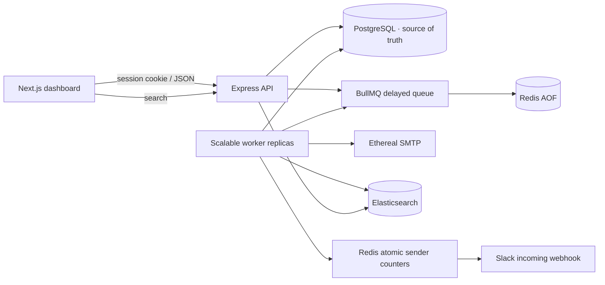

# ReachInbox Scheduler

A full-stack email scheduling workspace built around durable delayed jobs. The application keeps PostgreSQL as the source of truth, BullMQ/Redis as the delivery engine, Elasticsearch for search, and Ethereal SMTP for safe demo delivery.

## What is included

- TypeScript Express API and independent BullMQ worker.
- Persistent PostgreSQL records, stable BullMQ job IDs, payload-bound request idempotency, processing leases, and startup reconciliation for missing or stranded work.
- Configurable parallel worker capacity, a queue-wide send interval, and atomic Redis sender plus tenant-wide hourly limits. A sender limit can be set per campaign or inherited from `MAX_EMAILS_PER_HOUR_PER_SENDER`.
- Jobs that reach an hourly limit move to the next UTC hour window; they remain in BullMQ and are not discarded. A connected Slack incoming webhook receives one notification per sender and rate-limit window.
- Elasticsearch indexing/search, a live Bull Board queue view, Google OAuth login, Slack OAuth connect/disconnect, CSV/text recipient import, scheduled/sent views, and responsive dashboard.
- Docker Compose for PostgreSQL, Redis, and Elasticsearch.

## Architecture



The API writes a campaign and every recipient in one database transaction before queueing. The campaign idempotency key is bound to a canonical payload hash: an identical retry returns the original campaign, while a changed payload returns `409 Conflict`. Each recipient receives a stable job ID and a unique `(userId, idempotencyKey)` constraint. On API or worker startup and every five minutes while the API runs, reconciliation restores missing `SCHEDULED` jobs and reclaims `PROCESSING` rows whose lease expired. BullMQ delayed jobs survive worker/API restarts because Redis persistence is enabled. PostgreSQL remains authoritative for lifecycle state.

Workers use bounded concurrency, BullMQ's distributed queue limiter for minimum spacing, and one Redis Lua script that atomically checks per-sender and tenant-wide hourly counters across replicas. If either capacity is exhausted, the worker moves the current job to the start of the next UTC hour. Slack notifications are deduplicated by sender, limit scope, and hour. Ethereal SMTP is an external side effect: the system uses stable job IDs and durable state to prevent ordinary duplicate processing, but SMTP does not offer an idempotency key, so a process crash after SMTP accepts a message and before PostgreSQL records `SENT` cannot be made mathematically exactly-once. This boundary is called out rather than hidden.

The detailed [architecture decisions](docs/architecture.md), interactive [architecture diagram](docs/system-architecture.html), [OpenAPI contract](docs/openapi.yaml), and [assignment checklist](docs/assignment-brief.md) are included for review.

## Run locally

Requirements: Node.js 20+, pnpm 9+, and Docker Compose.

1. Copy `.env.example` to `.env` and provide credentials described below.
2. Start infrastructure: `docker compose up -d`.
3. Install dependencies: `pnpm install`.
4. Generate Prisma client and apply the committed migration: `pnpm db:generate && pnpm db:migrate`.
5. Start API and web: `pnpm dev`.
6. Start the worker in another terminal: `pnpm worker`.
7. Open `http://localhost:3000`. API health is at `http://localhost:4000/health`; Bull Board is at `http://localhost:4000/admin/queues` after signing in with an email listed in `BULL_BOARD_ADMIN_EMAILS`.

Rebuild the Elasticsearch projection at any time with `pnpm --filter @reachinbox/api reindex`. The API and worker are separate processes by design. Run multiple worker replicas for horizontal scaling; concurrency and send-rate controls are shared through Redis.

## Configuration

| Variable                                                          | Purpose                                                                                 |
| ----------------------------------------------------------------- | --------------------------------------------------------------------------------------- |
| `DATABASE_URL`                                                    | PostgreSQL connection string                                                            |
| `REDIS_URL`                                                       | Redis/BullMQ connection                                                                 |
| `ELASTICSEARCH_URL`                                               | Elasticsearch endpoint                                                                  |
| `SESSION_SECRET`                                                  | At least 32 characters; signs HTTP-only session cookies and OAuth state                 |
| `BULL_BOARD_ADMIN_EMAILS`                                         | Comma-separated Google account emails allowed to view the cross-tenant Bull Board       |
| `GOOGLE_CLIENT_ID`, `GOOGLE_CLIENT_SECRET`, `GOOGLE_CALLBACK_URL` | Google OAuth web client; add callback `http://localhost:4000/auth/google/callback`      |
| `ETHEREAL_USER`, `ETHEREAL_PASSWORD`                              | SMTP credentials from an Ethereal test account                                          |
| `ETHEREAL_HOST`, `ETHEREAL_PORT`                                  | SMTP server; defaults to Ethereal host and port 587                                     |
| `WORKER_CONCURRENCY`                                              | Per-worker concurrent job capacity (1–100)                                              |
| `MIN_SEND_INTERVAL_MS`                                            | Minimum queue-wide spacing between sends; defaults to 2 seconds                         |
| `MAX_EMAILS_PER_HOUR_PER_SENDER`                                  | Fallback per-sender UTC-hour cap; campaign cap overrides this value                     |
| `MAX_EMAILS_PER_HOUR_GLOBAL`                                      | Tenant-wide UTC-hour cap shared by every sender and worker replica                      |
| `PROCESSING_LEASE_MS`                                             | Age after which stranded `PROCESSING` rows can be recovered                             |
| `SLACK_CLIENT_ID`, `SLACK_CLIENT_SECRET`, `SLACK_REDIRECT_URI`    | Slack app OAuth; request the `incoming-webhook` scope and set the matching callback URL |
| `WEB_ORIGIN`, `API_PORT`                                          | Browser origin and API listen port                                                      |

Ethereal is a fake SMTP provider: messages are captured for preview and are not delivered to real inboxes. The worker prints the Ethereal preview URL after a successful send. For a local demo without Ethereal credentials, create an account at Ethereal Email and use its generated SMTP user/password.

Google OAuth and Slack OAuth are real flows; credentials cannot be bundled in this repository. Until they are configured, the API returns an actionable configuration response. Slack notifications use the incoming webhook URL returned by Slack OAuth and are skipped safely for users who have not connected Slack.

## API surface

- `GET /auth/google` and callback: Google OAuth sign-in.
- `GET /auth/me`, `POST /auth/logout`: current user/session.
- `GET /auth/slack`, callback, `DELETE /auth/slack`: connect/disconnect Slack notifications.
- `POST /api/emails`: create a batch of recipient messages. Body: `{ sender, senderName?, recipients[], subject, body, scheduledAt, delayBetweenMs?, hourlyLimit?, idempotencyKey }`. Maximum batch size is 5,000.
- `GET /api/emails?status=SCHEDULED|SENT|FAILED&limit=50&cursor=...`: cursor-paginated message list.
- `GET /api/emails/search?q=...&status=SENT`: search recipient, subject, and body in Elasticsearch, optionally scoped by lifecycle status.
- `GET /health`: database, Redis, and search dependency health.
- `GET /admin/queues`: authenticated Bull Board UI.

## Trade-offs and next steps

- PostgreSQL owns business state. Redis is a recoverable execution index; a production deployment should run Redis with managed persistence/replication and alert on queue lag.
- The search index is a projection and should be rebuilt from PostgreSQL if needed. Production hardening would move indexing to a transactional outbox so transient Elasticsearch outages never fail delivery bookkeeping.
- OAuth sessions are signed HTTP-only cookies. A production deployment should add CSRF protection, key rotation, encrypted secret storage, and tenant-level authorization policies.
- Campaign-level limits are immutable campaign settings, so later campaigns cannot change the pacing of already queued work. A production scheduler could additionally model durable sender and provider policies hierarchically.
- No cron jobs are used. Delayed BullMQ jobs and a startup reconciliation scan drive scheduling and recovery.

## Verification

Run `pnpm verify` to check formatting, execute the deterministic unit tests, type-check the API, and build the production Next.js bundle. The tests cover recipient normalization and pacing, stable payload fingerprints, conflict-sensitive idempotency, and exact UTC rate-window boundaries. Live OAuth, Slack, Elasticsearch, Redis, PostgreSQL, and SMTP behavior requires the credentials and containers described above.

## Project structure

```text
apps/api       Express API, auth, queue producer, worker, integrations
apps/web       Next.js dashboard and compose workflow
apps/api/prisma PostgreSQL data model
```
